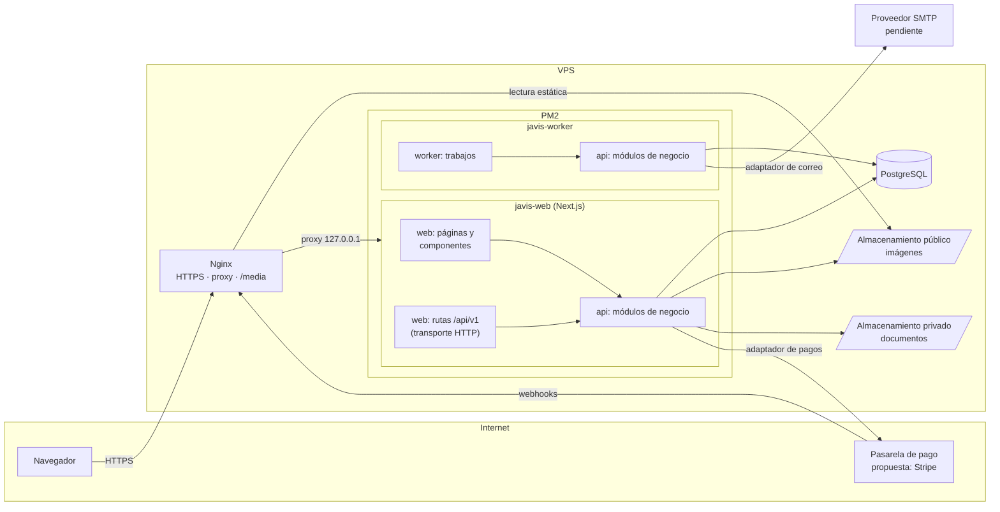
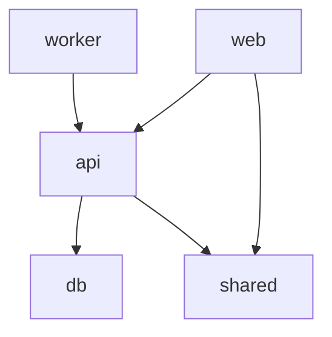

# Arquitectura

## Resumen

Javis Market es un **monolito modular** desplegado en el VPS del cliente:

- Una aplicación **Next.js** (App Router, React, TypeScript, Tailwind CSS) que sirve la tienda, el panel
  administrativo y las rutas HTTP.
- La lógica de negocio vive en un **paquete interno** (`api`) que se ejecuta dentro del mismo proceso de Next.js.
  No es un servidor separado.
- **PostgreSQL** como única base de datos, accedida con **Prisma** (paquete `db`).
- Un **worker** independiente para tareas diferidas, que reutiliza el mismo paquete `api`.
- **PM2** gestiona los procesos `javis-web` y `javis-worker`; **Nginx** hace de proxy inverso, termina HTTPS
  y sirve las imágenes públicas desde un directorio persistente.

Se descartan en esta etapa: microservicios, un segundo servidor HTTP, Docker, Kubernetes, Redis y colas externas
([ADR 0001](decisions/0001-modular-monolith.md)).

## Diagrama



## Componentes y responsabilidades

| Componente       | Carpeta                                                          | Responsabilidad                                                                                              |
| ---------------- | ---------------------------------------------------------------- | ------------------------------------------------------------------------------------------------------------ |
| Interfaz         | `web/src/app/(store)`, `web/src/app/admin`, `web/src/components` | Renderizado de la tienda y el panel. Sin reglas de negocio.                                                  |
| Transporte HTTP  | `web/src/app/api`                                                | Rutas delgadas: parsean la petición, llaman a un servicio de `api` y traducen el resultado a HTTP.           |
| Negocio          | `api/src/modules`                                                | Casos de uso, validaciones, autorización por operación, transacciones y reglas.                              |
| Adaptadores      | `api/src/adapters`                                               | Implementaciones intercambiables de pagos, correo y almacenamiento detrás de interfaces.                     |
| Infraestructura  | `api/src/infrastructure`, `api/src/config`                       | Logger, salud, configuración y utilidades técnicas comunes a los módulos.                                    |
| Persistencia     | `db`                                                             | Esquema Prisma, migraciones y cliente. No contiene reglas de negocio.                                        |
| Tareas diferidas | `worker`                                                         | Proceso independiente: vencimiento de reservas, envío de correos, reprocesamiento de eventos. Llama a `api`. |
| Contratos        | `shared`                                                         | Tipos y utilidades puras utilizables también en el navegador (dinero, forma de errores). Sin secretos ni BD. |

## Capas y flujo de una petición

```text
Navegador ──HTTP──▶ web/src/app/api/v1/... (ruta)      ─┐
Navegador ──RSC───▶ web/src/app/(store)/... (página)    ├─▶ api: servicio del módulo ─▶ db (Prisma) ─▶ PostgreSQL
Worker    ─────────▶ worker/src/jobs/...                ─┘            │
                                                                       └─▶ adaptadores (pagos, correo, archivos)
```

1. **Interfaz** (`web`): los componentes de servidor pueden llamar directamente a servicios de `api`, sin hacer
   una petición HTTP a la propia aplicación. Los componentes de cliente solo usan rutas HTTP y tipos de `shared`.
2. **Transporte HTTP** (`web/src/app/api`): valida forma de entrada, obtiene la identidad (sesión o token de
   invitado), llama al servicio y mapea errores a códigos HTTP ([api-conventions.md](api-conventions.md)).
   No accede a Prisma ni decide reglas de negocio.
3. **Negocio** (`api`): cada servicio recibe un contexto de actor y comprueba la autorización él mismo, de modo que
   la regla se aplica igual desde una página, una ruta o el worker.
4. **Persistencia** (`db`): solo el módulo propietario de un dato escribe en sus tablas ([modules.md](modules.md)).

## Dependencias entre paquetes



| Paquete  | Puede importar  | No puede importar                                       |
| -------- | --------------- | ------------------------------------------------------- |
| `web`    | `api`, `shared` | `db`, `@prisma/*`, `worker`                             |
| `worker` | `api`           | `db`, `@prisma/*`, `web`, Next.js, React                |
| `api`    | `db`, `shared`  | `web`, `worker`, Next.js, React                         |
| `db`     | —               | cualquier paquete interno                               |
| `shared` | —               | paquetes internos, `@prisma/*`, `server-only`, `node:*` |

Mecanismos que lo hacen cumplir:

- **ESLint** (`no-restricted-imports` en [`eslint.config.mjs`](../eslint.config.mjs)) bloquea las importaciones
  prohibidas de la tabla y las importaciones profundas (`@javis-market/api/src/...`).
- **`server-only`**: `api` y `db` lo importan en su punto de entrada. Si un componente cliente los importa,
  `next build` falla, por lo que ni la lógica del servidor ni Prisma pueden acabar en el bundle del navegador.
  El worker se ejecuta con la condición `react-server` para poder importarlos.
- **`exports`** en cada `package.json`: cada paquete expone una única entrada pública (`src/index.ts`).

## Organización del repositorio

npm workspaces: `shared`, `db`, `api`, `web`, `worker` ([ADR 0002](decisions/0002-repository-layout.md)).
Los paquetes internos se publican como código TypeScript (sin paso de compilación propio):

- Next.js los compila mediante `transpilePackages`.
- El worker se ejecuta con `tsx` (`node --import tsx`).
- `tsc --noEmit` comprueba los tipos de cada workspace con la configuración estricta de `tsconfig.base.json`.

Ajustes respecto a la estructura de referencia:

| Ajuste                                 | Motivo                                                                                                     |
| -------------------------------------- | ---------------------------------------------------------------------------------------------------------- |
| `db/prisma.config.ts`                  | Prisma 7 define la URL de conexión y las rutas en un archivo de configuración, no en el esquema.           |
| `db/src/generated/` (ignorado en git)  | Salida del generador `prisma-client`; se regenera en `postinstall` y en `build`.                           |
| `web/src/app/api/health/`              | Única ruta existente: comprobación de vida para PM2/Nginx/monitorización.                                  |
| `infra/nginx/javis-proxy-headers.conf` | Fragmento de cabeceras compartido por los `location` de la plantilla.                                      |
| ESLint y Prettier únicos en la raíz    | Una sola configuración para todo el monorepo, con reglas por carpeta.                                      |
| `.env` único en la raíz                | Next.js lo carga con `@next/env`, Prisma con `process.loadEnvFile` y el worker con `--env-file-if-exists`. |

## Ejecución

| Proceso        | Desarrollo           | Producción (PM2)                                           |
| -------------- | -------------------- | ---------------------------------------------------------- |
| `javis-web`    | `npm run dev`        | `next start --hostname 127.0.0.1 --port <APP_PORT>`        |
| `javis-worker` | `npm run dev:worker` | `node --import tsx --conditions=react-server src/index.ts` |

El worker se lanza inicialmente con una sola instancia. Los trabajos deben ser idempotentes y usar bloqueos en
PostgreSQL (p. ej. `SELECT … FOR UPDATE SKIP LOCKED`) si en el futuro se escalan instancias, sin introducir Redis.

Trabajos previstos (no implementados): liberar reservas de inventario vencidas, enviar correos pendientes desde
una tabla de salida (_outbox_), reprocesar eventos de pago y tareas de limpieza.

## Decisiones técnicas tomadas en esta etapa

| Decisión       | Valor                                                                                              |
| -------------- | -------------------------------------------------------------------------------------------------- |
| Runtime        | Node.js 24 LTS                                                                                     |
| Framework      | Next.js 16.4 (Turbopack), React 19.3                                                               |
| Lenguaje       | TypeScript 6.0, modo estricto (`strict`, `noUncheckedIndexedAccess`, `exactOptionalPropertyTypes`) |
| Estilos        | Tailwind CSS 4.3 con configuración CSS-first (`@theme` en `globals.css`)                           |
| ORM            | Prisma 7.10 con generador `prisma-client` y adaptador `@prisma/adapter-pg`                         |
| Lint / formato | ESLint 9 (flat config, `eslint-config-next`, `typescript-eslint`) y Prettier 3                     |

Notas sobre versiones: TypeScript 7 y ESLint 10 ya existen, pero `typescript-eslint` todavía exige TS < 6.1 y
los plugins de `eslint-config-next` no declaran soporte para ESLint 10. La etiqueta `latest` de `prisma` apunta a
una versión candidata (8.0 RC), por lo que se fija la última estable (7.10.1). Revisar estas versiones antes de
iniciar el desarrollo.
