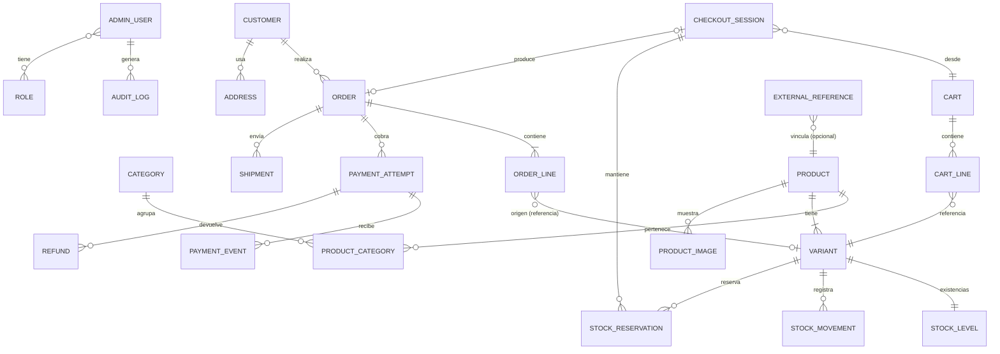

# Modelo de datos conceptual

> Modelo **conceptual**. No es el esquema definitivo: nombres, campos y relaciones se concretarán en
> `db/prisma/schema.prisma` y sus migraciones durante el desarrollo. Todavía no existe ninguna tabla comercial.

## Convenciones previstas

- Identificadores internos opacos (p. ej. UUID/ULID). Los números visibles (número de pedido) son campos aparte.
- Importes en **centavos enteros** acompañados de **moneda** (`USD`) ([checkout-inventory-payments.md](checkout-inventory-payments.md)).
- Fechas en UTC (`timestamptz`); `createdAt` y `updatedAt` en todas las entidades.
- Estados como enumeraciones explícitas.
- Borrado lógico (`archivedAt`) para entidades referenciadas por pedidos (productos, variantes); los pedidos no se borran.

## Diagrama

## Catálogo

**Product**: nombre, _slug_, descripción, estado (`draft`, `active`, `archived`), proveedor de origen
(Deliflow u otro), marca, atributos descriptivos.

**Category**: nombre, _slug_, categoría padre opcional, orden. Relación muchos a muchos con productos.

**Variant (SKU)**: unidad vendible y unidad de inventario. SKU único, opciones (p. ej. talla/tamaño), precio de venta
(centavos + moneda), precio de comparación opcional, coste opcional (solo panel), peso/dimensiones para envíos,
estado. Todo producto tiene al menos una variante.

**ProductImage**: clave de almacenamiento (generada por el servidor), texto alternativo, orden, variante opcional,
procedencia y autorización (p. ej. "imagen autorizada de Deliflow"), dimensiones y tipo.

## Inventario

**StockLevel** (por variante): `onHand` (físico) y `reserved` (reservado). Disponible = `onHand − reserved`,
calculado, nunca almacenado por separado. Restricciones: `onHand ≥ 0`, `0 ≤ reserved ≤ onHand`.

**StockMovement**: registro inmutable de cada cambio de `onHand`: variante, cantidad (+/−), motivo (`receipt`,
`adjustment`, `sale`, `return_restock`, `count`), referencia (pedido, ajuste), actor, nota.

**StockReservation**: variante, cantidad, sesión de checkout, estado (`active`, `consumed`, `released`, `expired`),
`expiresAt`. Ubicación única en v1 (un solo almacén); multi-almacén no está previsto.

## Carrito

**Cart**: identificado por un token aleatorio en cookie (invitado), moneda, estado (`open`, `converted`,
`abandoned`), última actividad.

**CartLine**: variante, cantidad. El precio mostrado en el carrito es indicativo y se recalcula; no se congela hasta
crear el pedido.

**CheckoutSession**: carrito de origen, estado, totales calculados (subtotal, envío, impuestos, total),
datos de contacto y dirección capturados, reservas asociadas, vencimiento, clave de idempotencia.

## Pedidos

**Order**: número visible, cliente, estado del pedido, estado de pago (derivado de los intentos), estado de
preparación/envío, moneda, subtotal, descuentos, envío, impuestos, total, copia de la dirección de envío y
facturación, email de contacto, hash del token de acceso del invitado, notas.

**OrderLine**: copia histórica de lo vendido: SKU, nombre del producto y de la variante, opciones, imagen
principal, precio unitario, cantidad, impuestos y total de línea. Referencia opcional a la variante de origen
(puede archivarse sin afectar al pedido).

**Shipment**: método, transportista, número de seguimiento, estado, líneas/cantidades enviadas, fechas.
Métodos y tarifas pendientes de definir.

## Clientes

**Customer**: email, nombre, teléfono. En v1 se crea o reutiliza por email en cada compra como invitado; no tiene
credenciales.

**Address**: nombre, líneas de dirección, ciudad, estado, código postal (ZIP), país (`US`), teléfono. El pedido
guarda su propia copia; editar una dirección no altera pedidos anteriores.

## Pagos

**PaymentAttempt**: pedido, proveedor (`stripe` propuesto), identificador del pago en el proveedor, importe y
moneda, estado (`pending`, `requires_action`, `succeeded`, `failed`, `canceled`), clave de idempotencia.

**PaymentEvent**: proveedor, identificador del evento en el proveedor (**único**), tipo, carga útil cruda,
firma verificada, fecha de recepción y de procesamiento, resultado del procesamiento. Permite idempotencia y
reprocesamiento.

**Refund**: intento de pago, importe, motivo, estado, identificador en el proveedor, admin que lo solicitó,
clave de idempotencia.

## Administración y auditoría

**AdminUser**: email, nombre, estado, datos de autenticación gestionados por la librería elegida
([security.md](security.md)).

**Role / Permission**: roles con permisos `recurso:acción` ([modules.md](modules.md#permisos)).

**AuditLog**: actor (admin o sistema), acción, entidad y su identificador, cambios relevantes (antes/después,
sin secretos), IP, agente de usuario, fecha. Solo inserción.

## Infraestructura de procesos

**OutboxMessage** (correo y otras tareas diferidas): tipo, carga, estado, intentos, siguiente reintento, último
error. Lo escribe la transacción de negocio y lo consume el worker.

**IdempotencyKey**: clave, ámbito, hash de la petición, respuesta almacenada, vencimiento.

## Referencias externas (sujetas a definir la integración)

**ExternalReference**: sistema (`deliflow`, `invello`, …), tipo de entidad local, identificador local,
identificador externo, fecha de última sincronización. Permite vincular entidades sin acoplar el esquema a un
sistema externo. No se definen campos específicos de Invello hasta conocer el alcance ([integrations.md](integrations.md)).
