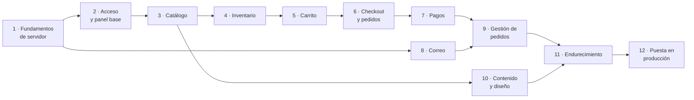

# Plan de desarrollo — primera versión

Plan para construir la primera versión de Javis Market sobre la base descrita en
[architecture.md](architecture.md). Ordena el trabajo por fases, marca qué depende de decisiones pendientes
([scope.md](scope.md#asuntos-pendientes)) y define cuándo se considera terminada cada fase.

No incluye fechas: dependen del tamaño del equipo y de cuándo se resuelvan las decisiones pendientes. El tamaño
relativo (S/M/L) sirve para comparar fases entre sí.

## Estado (2026-10-30)

| Fase            | Estado      | Notas                                                                                                                                                                                                                                         |
| --------------- | ----------- | --------------------------------------------------------------------------------------------------------------------------------------------------------------------------------------------------------------------------------------------- |
| 1 · Fundamentos | ✅ Parcial  | Vitest/Playwright, Zod, errores de dominio, actor, dinero, pruebas con PostgreSQL. **Aplazado** a las fases que lo usan: _outbox_ e idempotencia (6–8), ejecutor de trabajos del worker (6), `/api/health/ready`, CI (sin repositorio remoto) |
| 2 · Acceso      | ✅          | Better Auth, rol único `admin`, alta por CLI, auditoría y panel base                                                                                                                                                                          |
| 3 · Catálogo    | ✅          | Productos, variantes, categorías, fotos (subida e importación por URL al VPS), tienda pública                                                                                                                                                 |
| 4 · Inventario  | ✅          | Existencias, movimientos, ajustes atómicos; las reservas llegan con el checkout                                                                                                                                                               |
| 5 · Carrito     | ✅          | Carrito de invitado con cookie; sin reservas                                                                                                                                                                                                  |
| 10 · Diseño     | 🟡 Temporal | Diseño provisional hasta recibir logo e identidad visual                                                                                                                                                                                      |
| 6–9, 11–12      | ⏳          | Siguiente: checkout y pedidos (fase 6)                                                                                                                                                                                                        |

Decisiones tomadas durante el desarrollo: [ADR 0005](decisions/0005-admin-authentication.md) (autenticación),
[ADR 0006](decisions/0006-product-images.md) (imágenes) y [ADR 0007](decisions/0007-single-admin-role.md) (rol único).

## Principios

- **Avanzar sin bloquearse.** Lo que depende de una decisión pendiente se construye contra una interfaz con una
  implementación provisional (adaptador falso, cálculo configurable). Al confirmarse la decisión solo se sustituye
  la implementación.
- **De dentro hacia fuera.** En cada funcionalidad: modelo y migración → servicio con autorización y pruebas →
  ruta o página → interfaz.
- **Vertical y desplegable.** Cada fase termina con algo que funciona de extremo a extremo y deja `main` en estado
  desplegable.
- **Reglas en un solo sitio.** Las reglas de dinero, inventario y pagos de
  [checkout-inventory-payments.md](checkout-inventory-payments.md) se implementan una vez, en su módulo propietario
  ([modules.md](modules.md)).

## Vista general

| Fase | Nombre                  | Tamaño | Bloqueada por decisión                                                |
| ---- | ----------------------- | ------ | --------------------------------------------------------------------- |
| 1    | Fundamentos de servidor | M      | Herramientas de pruebas (se propone en la fase)                       |
| 2    | Acceso y panel base     | M      | Librería de autenticación (ADR al inicio de la fase), roles           |
| 3    | Catálogo                | L      | — (datos de Deliflow solo afectan a la carga)                         |
| 4    | Inventario              | M      | —                                                                     |
| 5    | Carrito                 | S      | —                                                                     |
| 6    | Checkout y pedidos      | L      | Envíos e impuestos (provisionales hasta confirmar), tiempo de reserva |
| 7    | Pagos                   | L      | Pasarela y credenciales de prueba                                     |
| 8    | Correo                  | S      | Proveedor SMTP (adaptador de log hasta entonces)                      |
| 9    | Gestión de pedidos      | M      | Políticas de devoluciones y cancelaciones                             |
| 10   | Contenido y diseño      | M      | Identidad visual, textos legales, idioma                              |
| 11   | Endurecimiento          | M      | —                                                                     |
| 12   | Puesta en producción    | M      | VPS, dominio, destino de copias, credenciales reales                  |

Las fases 3 y 8 pueden avanzar en paralelo con otras si hay más de una persona; el camino crítico es
1 → 2 → 3 → 4 → 5 → 6 → 7 → 9 → 11 → 12.

## Fase 1 — Fundamentos de servidor

**Objetivo:** las piezas comunes que usarán todos los módulos, para no reinventarlas en cada uno.

Entregables:

- Herramientas de pruebas: Vitest para pruebas unitarias e integración y Playwright para e2e (propuesta; se
  registra en un ADR). PostgreSQL de pruebas recreado por la suite (`tests/integration`).
- Validación con Zod en el borde HTTP y utilidades para reutilizar esquemas.
- Errores de dominio tipados en `api` y un único adaptador en `web` que los convierte al formato de
  [api-conventions.md](api-conventions.md#errores), con `X-Request-Id`.
- Contexto de actor (`admin` / `guest` / `system`) que reciben todos los servicios.
- Utilidades de dinero (`Money`): suma, multiplicación por cantidad y redondeo documentado, con pruebas.
- Tablas técnicas y su migración: `OutboxMessage`, `IdempotencyKey`.
- Ejecutor de trabajos del worker sobre PostgreSQL (`FOR UPDATE SKIP LOCKED`), con reintentos y backoff.
- Comprobación de disponibilidad (`/api/health/ready`) que consulta la base de datos, separada de `/api/health`.
- Integración continua (lint, tipos, pruebas, build) en cuanto exista repositorio remoto.

Criterios de aceptación:

- `npm run check` y `npm test` pasan en local y en CI.
- Una prueba de integración demuestra que el worker procesa un mensaje de prueba una sola vez aunque haya dos
  ejecuciones concurrentes.

## Fase 2 — Acceso y panel base

**Objetivo:** que un administrador pueda entrar al panel de forma segura y que cada operación quede autorizada y
auditada.

Entregables:

- ADR con la librería de autenticación elegida (criterios en [security.md](security.md)).
- Modelos `AdminUser`, `Role`, permisos y sesiones; `AuditLog`.
- Inicio y cierre de sesión, caducidad de sesión, bloqueo progresivo, MFA si se confirma.
- Script de línea de comandos para crear el primer administrador (sin credenciales en el repositorio).
- Comprobación de permisos `recurso:acción` reutilizable por los servicios.
- Esqueleto del panel `/admin`: layout, navegación, páginas protegidas en el servidor.
- Gestión de usuarios administrativos y roles (`access:manage`).

Criterios de aceptación:

- Sin sesión, cualquier página o ruta `/admin` devuelve redirección o `401`; sin permiso, `403`.
- Pruebas de autorización por servicio, no solo por ruta.
- Inicios de sesión y cambios de permisos aparecen en la auditoría.

## Fase 3 — Catálogo

**Objetivo:** gestionar productos desde el panel y mostrarlos en la tienda.

Entregables:

- Modelos `Product`, `Category`, `Variant` (SKU), `ProductImage` según [data-model.md](data-model.md#catálogo).
- Adaptador de almacenamiento en disco (`FileStorage`) con directorios público y privado.
- Subida de imágenes: validación por contenido, reencode, eliminación de metadatos y registro de procedencia
  (incluida "imagen autorizada de Deliflow").
- Panel: alta, edición, archivado y publicación de productos, variantes, precios y categorías.
- Tienda: portada provisional, listado por categoría, ficha de producto, búsqueda básica.
- Datos mínimos de desarrollo generados por un script de _seed_ local (no se versionan datos reales).

Criterios de aceptación:

- Solo productos `active` son visibles en la tienda; los precios se muestran desde centavos con la moneda.
- Una imagen no válida (tipo falso, demasiado grande, SVG) se rechaza.
- Cambios de precio quedan auditados.

## Fase 4 — Inventario

**Objetivo:** existencias propias con movimientos trazables.

Entregables:

- Modelos `StockLevel`, `StockMovement`, `StockReservation` con restricciones `CHECK`.
- Servicios de entrada, ajuste y recuento (`inventory:adjust`), cada uno con movimiento y auditoría.
- Cálculo de disponibilidad (`onHand − reserved`, ignorando reservas vencidas).
- Panel: existencias por variante, historial de movimientos, ajustes.
- Tienda: indicador de disponibilidad en la ficha de producto.

Criterios de aceptación:

- Pruebas de integración concurrentes: N reservas simultáneas sobre stock limitado nunca superan el físico.
- Ningún cambio de `onHand` ocurre sin un movimiento asociado.

## Fase 5 — Carrito

**Objetivo:** carrito de invitado persistente.

Entregables:

- Modelos `Cart` y `CartLine`; cookie con token aleatorio.
- Añadir, cambiar cantidad, eliminar; recálculo con precios vigentes; avisos de variantes no disponibles.
- Interfaz de carrito en la tienda.

Criterios de aceptación:

- Añadir al carrito no reserva inventario.
- El cliente no puede fijar precios: solo envía variante y cantidad.

## Fase 6 — Checkout y pedidos

**Objetivo:** convertir un carrito en un pedido pendiente de pago con inventario reservado.

Entregables:

- `CheckoutSession` con datos de contacto y dirección de EE. UU.
- Interfaces `ShippingCalculator` y `TaxCalculator` con implementaciones **provisionales configurables** desde el
  panel (tarifa fija y tasa configurable). Se sustituirán cuando se definan envíos e impuestos; no se publicará
  la tienda con valores inventados.
- Reserva atómica de todas las líneas con vencimiento; trabajo del worker que libera reservas vencidas.
- Creación del pedido con copia histórica de líneas y direcciones; número de pedido visible.
- Token de acceso de invitado (solo se guarda su _hash_) y página de consulta del pedido
  ([api-conventions.md](api-conventions.md#pedidos-de-invitados)).
- `Idempotency-Key` en la creación de la sesión y del pedido.

Criterios de aceptación:

- Totales calculados solo en el servidor y revalidados antes de crear el pedido.
- Doble envío del formulario produce un único pedido.
- Sin token válido, un pedido de invitado responde `404`.

## Fase 7 — Pagos

**Objetivo:** cobrar el pedido y confirmarlo solo con verificación del servidor.

Entregables:

- Adaptador de pagos falso para desarrollo y pruebas (simula éxito, fallo, duplicados y retrasos).
- Implementación de la pasarela elegida (Stripe si se confirma) en `adapters/payments/<proveedor>/`.
- Modelos `PaymentAttempt`, `PaymentEvent`, `Refund`.
- Webhook con cuerpo crudo y verificación de firma; registro idempotente de eventos.
- Confirmación transaccional: evento, intento, consumo de reservas, pedido pagado y _outbox_ de correo.
- Trabajo de reconciliación de intentos `pending`; tratamiento de pagos tardíos y pedidos cancelados
  ([checkout-inventory-payments.md](checkout-inventory-payments.md#8-reintentos-duplicados-y-pagos-tardíos)).

Criterios de aceptación:

- Pruebas para: evento duplicado, eventos fuera de orden, webhook perdido, pago tras vencer la reserva, importe que
  no coincide.
- La página de retorno del navegador no cambia ningún estado.
- Recorrido completo en modo prueba de la pasarela, una vez existan credenciales de prueba.

## Fase 8 — Correo

**Objetivo:** notificaciones fiables que nunca bloquean una compra.

Entregables:

- Adaptador de correo de log (desarrollo) e implementación SMTP cuando se elija proveedor.
- Envío desde el worker vía _outbox_ con reintentos y registro de fallos.
- Plantillas: confirmación de pedido (con enlace de acceso de invitado), cambios de estado y envío, reenvío desde
  el panel.

Criterios de aceptación:

- Con el proveedor caído, el pedido se confirma igualmente y el correo se reintenta.

## Fase 9 — Gestión de pedidos

**Objetivo:** que el equipo opere los pedidos desde el panel.

Entregables:

- Listado y detalle de pedidos con filtros y paginación por cursor.
- Estados de preparación y envío, `Shipment` con transportista y seguimiento.
- Cancelación, reembolso total o parcial (`payments:refund`) y reingreso de inventario (`inventory:restock`) como
  operaciones separadas.
- Cola de pedidos `needs_review` (pagos tardíos, importes no coincidentes).
- Datos de clientes y direcciones (`customers:read`).

Criterios de aceptación:

- Un reembolso no reingresa inventario y viceversa; ambos auditados y limitados a lo cobrado/vendido.

## Fase 10 — Contenido y diseño

**Objetivo:** aspecto definitivo y páginas obligatorias.

Entregables:

- Aplicación de la identidad visual (logo, colores, tipografías) sobre los tokens de Tailwind.
- Diseño de portada, listados, ficha, carrito, checkout y confirmación; versión móvil.
- Módulo `content`: páginas legales e informativas editables (envíos, devoluciones, privacidad, términos).
- SEO básico: metadatos, _sitemap_, `robots.txt`, datos estructurados de producto.
- Accesibilidad (WCAG 2.1 AA como objetivo).

Criterios de aceptación:

- Las páginas legales existen y están enlazadas desde el pie y el checkout.

## Fase 11 — Endurecimiento

**Objetivo:** preparar la tienda para tráfico real.

Entregables:

- Límites de solicitudes en la aplicación (contadores en PostgreSQL) y en Nginx.
- CSP y cabeceras de seguridad ajustadas a la pasarela de pago.
- Pruebas e2e del recorrido de compra y del panel.
- Revisión de seguridad (autorización por servicio, secretos, subida de archivos, pedidos de invitado).
- Revisión de rendimiento: caché de páginas de catálogo, índices de base de datos, tamaño de imágenes.

Criterios de aceptación:

- Suite e2e verde; sin hallazgos de seguridad abiertos de severidad alta.

## Fase 12 — Puesta en producción

**Objetivo:** desplegar en el VPS del cliente con operación segura.

Entregables:

- Preparación del VPS según [deployment.md](deployment.md): usuario sin privilegios, PostgreSQL con roles
  separados, directorios persistentes, PM2, Nginx, certificados.
- Scripts de copia de seguridad y restauración en `scripts/`, con una restauración probada.
- Rotación de logs y monitorización externa de `/api/health`.
- Credenciales de producción de pagos y correo; DNS del dominio; SPF/DKIM/DMARC.
- Lista de comprobación de lanzamiento y compra real de prueba con reembolso.

Criterios de aceptación:

- Despliegue y vuelta atrás ensayados con el procedimiento documentado.
- Copia de seguridad externa verificada antes de abrir la tienda.

## Fuera de la primera versión

- Integración con Invello (requiere definir alcance; ver [integrations.md](integrations.md#invello)).
- Importación automática desde Deliflow.
- Cuentas de cliente, cupones y promociones, varios almacenes, varios idiomas o monedas.

## Decisiones necesarias y cuándo

| Decisión pendiente                        | Necesaria antes de                       |
| ----------------------------------------- | ---------------------------------------- |
| Herramientas de pruebas                   | Fase 1 (se propone en ella)              |
| Librería de autenticación                 | Fase 2                                   |
| Roles administrativos reales              | Fase 2                                   |
| Tiempo de reserva en checkout             | Fase 6                                   |
| Pasarela de pago y credenciales de prueba | Fase 7                                   |
| Proveedor SMTP                            | Fase 8 (adaptador de log hasta entonces) |
| Políticas de devoluciones y cancelaciones | Fase 9                                   |
| Identidad visual, idioma y textos legales | Fase 10                                  |
| Métodos y tarifas de envío                | Fase 12 (provisionales hasta entonces)   |
| Reglas de impuestos                       | Fase 12 (provisionales hasta entonces)   |
| VPS, dominio y destino de copias          | Fase 12                                  |
| Alcance de Invello                        | Después de la v1                         |

## Forma de trabajo

- Ramas cortas por funcionalidad y _pull requests_ hacia `main`, con `npm run check` y pruebas en verde.
- Cada cambio de esquema incluye su migración versionada; nunca `db push` fuera de desarrollo local.
- Toda decisión técnica relevante se registra como ADR en [decisions/](decisions/).
- **Definición de terminado** para cada funcionalidad: servicio con autorización y pruebas, migración, ruta o
  página, auditoría donde corresponda, documentación actualizada y build sin credenciales.
